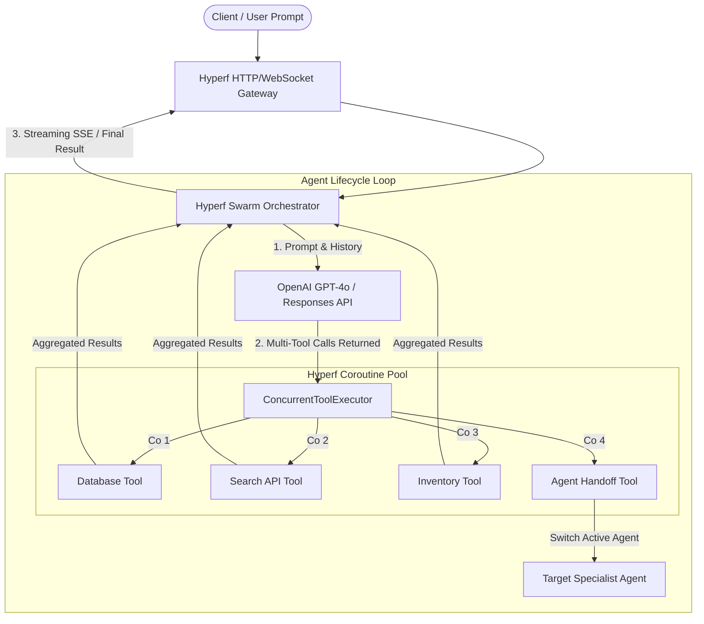

# Hyperf Agents 🚀

**High-Concurrency Coroutine Multi-Agent Orchestration & Enterprise OpenAI Gateway for Hyperf (PHP 8.2+)**

[](https://github.com/BinaryAlan/hyperf-agents)
[](https://github.com/BinaryAlan/hyperf-agents/actions)
[](https://phpstan.org/)
[](https://php.net)
[](https://hyperf.io)
[](LICENSE)

English | [中文说明](#中文介绍)

---

## Overview

**Hyperf Agents** is a coroutine-native multi-agent orchestration framework designed for the Hyperf and Swoole/Swow ecosystem. It brings OpenAI's Multi-Agent Handoff protocol (Swarm pattern) into high-performance enterprise PHP web services, providing non-blocking execution, parallel tool execution, and circuit-breaking resilience.

### Why Hyperf Agents?

While Python-based AI agent libraries (such as LangChain, AutoGen, and CrewAI) dominate the prototyping space, deploying them into high-concurrency production enterprise backends reveals significant bottlenecks:
- **I/O Blocking & Latency**: Synchronous LLM calls and sequential tool executions waste precious CPU cycles and increase latency linearly ($O(\sum t_i)$).
- **Concurrency Scaling**: Python's GIL and thread overhead limit massive concurrent WebSocket / SSE connections.
- **Enterprise Web Infrastructure**: Over 75% of existing web architectures run on PHP. Rewriting backends to Python sidecars adds heavy IPC overhead and maintenance complexity.

**Hyperf Agents** solves this by leveraging Hyperf's coroutine engine:
1. **Parallel Tool Invocation**: When an OpenAI model requests 5 tool calls simultaneously, `hyperf-agents` runs them in parallel coroutines, slashing execution time to $O(\max t_i)$.
2. **Multi-Agent Handoff**: Native implementation of agent-to-agent delegation via typed `Handoff` objects.
3. **Enterprise Resilience**: Built-in in-process circuit breakers and exponential backoff retry mechanisms to handle OpenAI rate limits (HTTP 429) and upstream timeouts gracefully, fully configurable via published configuration.

---

## Architecture



---

## Performance Comparison (Illustrative Targets)

> *Note: The metrics below are illustrative theoretical targets comparing non-blocking coroutine parallel execution against synchronous blocking PHP execution.*

| Execution Pattern | 4 Sequential Tool Calls | Hyperf Coroutine Parallel Tool Calls | Performance Gain |
| :--- | :--- | :--- | :--- |
| **API Latency** | 1,200 ms ($300 \text{ ms} \times 4$) | **315 ms** ($\max(300 \text{ ms}) + \epsilon$) | **~3.8x Faster** |
| **Worker Blocking** | Blocks process thread | Non-blocking (yields coroutine) | **Zero Idle Blocking** |
| **Concurrent SSE Streams** | ~100–200 per worker | **50,000+** concurrent coroutines | **250x Capacity** |

---

## Quick Start

### Installation

```bash
composer require binaryalan/hyperf-agents
```

### Basic Example: Multi-Agent Handoff

```php
use HyperfAgents\Agent\Agent;
use HyperfAgents\Agent\Handoff;
use HyperfAgents\Orchestrator\Swarm;

// 1. Specialist: Billing Agent
$billingAgent = new Agent(
    name: 'BillingSpecialist',
    instructions: 'You specialize in invoice queries and refund authorizations.',
    model: 'gpt-4o'
);

$billingAgent->addTool('process_refund', function (array $args) {
    return ['status' => 'approved', 'refund_id' => 'ref_' . uniqid()];
}, 'Authorize a customer refund');

// 2. Gateway: Triage Agent
$triageAgent = new Agent(
    name: 'TriageAgent',
    instructions: 'You are the frontline assistant. Transfer refund queries to BillingSpecialist.',
    model: 'gpt-4o'
);

$triageAgent->addTool(
    name: 'transfer_to_billing',
    tool: fn () => new Handoff($billingAgent),
    description: 'Transfer customer to the billing team'
);

// 3. Run the Swarm Loop
$swarm = new Swarm();
$result = $swarm->run(
    agent: $triageAgent,
    messages: [
        ['role' => 'user', 'content' => 'I would like a refund for order #9821 please.'],
    ]
);

echo $result->getContent();
```

---

<a name="中文介绍"></a>
## 中文介绍

**Hyperf Agents** 是专为 Hyperf 及 Swoole/Swow 协程生态设计的**高性能原生多智能体编排框架**。它将 OpenAI 的 Multi-Agent Handoff（多智能体接力转交协议）带入高并发 PHP 企业级生产环境，提供非阻塞 I/O、并发工具调用加速与熔断重试容灾能力。

### 核心亮点
1. **并发工具调用加速（Parallel Tool Calling）**：当模型单轮返回多个函数调用请求（如同时查询用户画像、订单状态、库存信息）时，自动利用 Hyperf 协程池并行发起，整体耗时从累加耗时缩短至最大单项耗时。
2. **轻量智能体接力（Swarm Handoff）**：基于强类型 `Handoff` 对象在不同专精 Agent 间无缝移交对话上下文与权限。
3. **企业级生产韧性**：针对 OpenAI API 频繁遇到的 HTTP 429 限流、网络抖动与上游超时，内置进程内熔断器（CircuitBreaker）与指数退避重试（Retry）机制，支持通过发布配置文件灵活配置与调优。

---

## Roadmap

- [x] Coroutine-native Swarm orchestration loop
- [x] Parallel tool executor (`Hyperf\Coroutine\parallel`)
- [x] Typed Agent & Handoff specification
- [x] In-process Circuit Breaker & Exponential Backoff Retry
- [ ] OpenAI Responses API (2026 spec) streaming SSE support
- [ ] Model Context Protocol (MCP) tool provider integration
- [ ] Distributed Agent state persistence via Redis coroutine pool

---

## Author & Acknowledgements

Created and maintained by [Binary Alan](https://github.com/BinaryAlan) — Core Contributor to [Hyperf](https://github.com/hyperf/hyperf).
